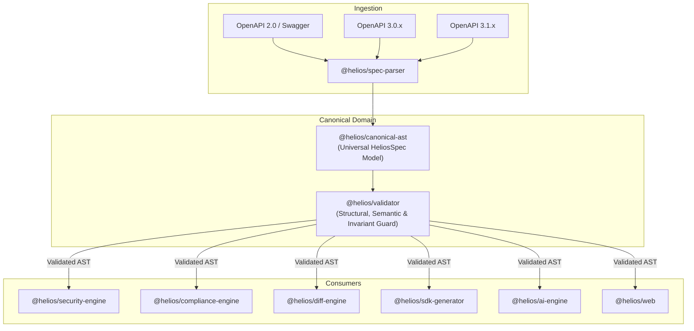
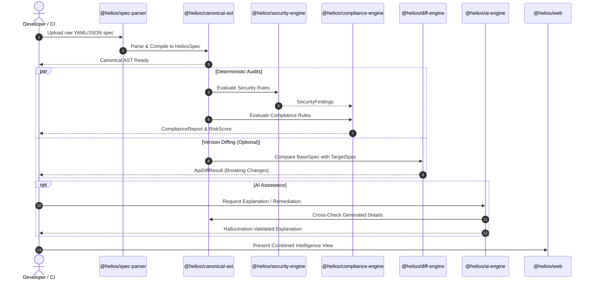

# HELIOS System Architecture & Design Specification

This document details the architectural principles, inter-package communication protocols, data flows, and design rationale of the HELIOS developer platform.

---

## 1. Why a Canonical Intermediate Representation is Needed

OpenAPI specifications exist across three major incompatible standards:
- **OpenAPI 2.0 (Swagger):** Parameter definitions use `in: body` or `in: formData`. JSON Schema is an ad-hoc dialect with `type: "file"`. Response definitions lack structured content-type multiplexing.
- **OpenAPI 3.0:** Introduces `requestBody` with media-type maps (`application/json`, `multipart/form-data`), separates query/path parameters, uses extended JSON Schema draft-04/05 with `nullable: true`, and replaces `host`/`basePath` with parameterized `servers`.
- **OpenAPI 3.1:** Full alignment with JSON Schema Draft 2020-12, replaces `nullable: true` with union types like `type: ["string", "null"]`, and introduces `webhooks`.

### The Combinatorial Explosion Problem

If the system allowed downstream engines (Security, Compliance, Diffing, SDK Generation, AI Copilot) to inspect raw OpenAPI objects directly, every single engine would require three distinct codepaths:

$$\text{Complexity} = O(N_{\text{engines}} \times M_{\text{dialects}})$$

For $N = 6$ engines and $M = 3$ dialects, at least 18 dialect-specific inspection logic branches would be required. Any modification to a security rule would risk breaking compatibility with OpenAPI 2.0 or 3.1.

### The Canonical AST Solution



By normalizing all specifications into `@helios/canonical-ast` at ingestion:
1. **Dialect Decoupling:** Downstream engines interact exclusively with `HeliosSpec`, `HeliosEndpoint`, `HeliosSchema`, and `HeliosSecurityScheme`.
2. **Schema Uniformity:** Schemas are represented with consistent property dictionaries, unified nullability semantics, and resolved references.
3. **Source-Map Preservation:** Each AST node retains a `SourceLocation` (line, column, source path) allowing findings generated on the AST to pinpoint exact locations in the original YAML or JSON file.

---

## 2. Component Communication & Data Flow



### Protocol Guidelines
- **Zero Side-Effects:** AST instances are immutable data structures. Engines receive a read-only reference to `HeliosSpec` and return new diagnostic result objects.
- **Result Pattern:** Operations that may fail return `Result<T, E>` from `@helios/shared`, eliminating uncaught exceptions.
- **Topological Package Layering:**
  ```
  @helios/web  /  Headless CLI
       │
       ▼
  @helios/ai-engine
       │
       ▼
  @helios/compliance-engine  ──▶  @helios/security-engine
       │                                │
       ▼                                ▼
  @helios/diff-engine        ──▶  @helios/canonical-ast
       │                                ▲
       ▼                                │
  @helios/sdk-generator      ──▶  @helios/spec-parser
       │                                │
       └────────────────────────────────┴──▶ @helios/shared
  ```

---

## 3. Strict Separation of Deterministic Analysis from AI Explanations

A non-negotiable architectural rule of HELIOS is that **probabilistic LLMs must never make deterministic security or compliance decisions**.

| Dimension | Deterministic Engines (`security`, `compliance`, `diff`) | AI Copilot (`ai-engine`) |
| :--- | :--- | :--- |
| **Execution** | Pure, deterministic TypeScript functions. | Local Ollama LLM execution with temperature control. |
| **Reproducibility** | 100% bit-exact across multiple runs and environments. | Generative natural-language responses. |
| **Responsibility** | Detecting vulnerabilities, calculating risk scores, flagging breaking changes. | Explaining findings, translating to plain English, suggesting code fixes. |
| **Validation** | Verified through automated unit test fixtures. | Validated against AST ground truth; output rejected if hallucinated. |

### Ground-Truth AST Validation

When the AI engine suggests a remediation or mentions an API property:
1. The AI engine extracts entity references (endpoint paths, parameter names, response codes).
2. The entity references are looked up in the `HeliosSpec` AST.
3. If an entity does not exist in the AST, the output is flagged with a `hallucinationWarning` or rejected before display to the operator.

---

## 4. Modularity and Headless Execution

HELIOS is built with the principle that **the web UI is just one consumer of the platform**.

1. **Standalone Core Libraries:** All packages in `packages/*` target standard ECMAScript modules (ESM) with Node.js support. None depend on React, DOM, or browser-specific APIs.
2. **Headless & CI Readiness:** A future CLI or GitHub Action can import `@helios/spec-parser`, `@helios/security-engine`, and `@helios/diff-engine` to block pull requests containing critical vulnerabilities or breaking API changes without starting a server.
3. **Pluggable Architecture:** Adding a new security rule or compliance standard is as simple as registering an object implementing `SecurityRule` or `ComplianceControlMapping`.
