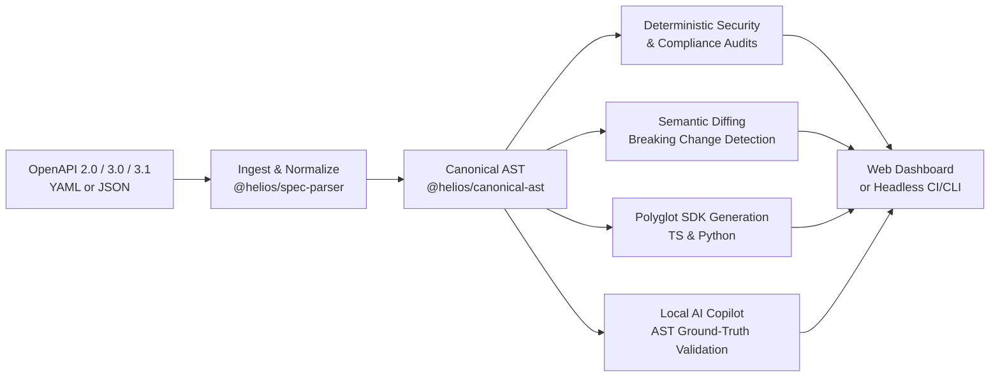
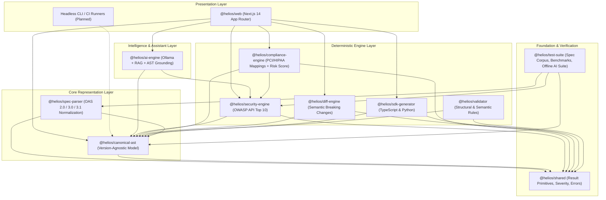

# HELIOS: Enterprise API Intelligence, Security & AI Assistant Platform

HELIOS is an enterprise-grade developer platform that provides end-to-end API intelligence, deterministic security checks, regulatory compliance mapping, breaking change detection, polyglot SDK generation, and an offline-verified local AI copilot.

---

## 1. Product Overview

Modern API ecosystems suffer from specification drift, security vulnerabilities, silent breaking changes, and disconnected tooling. Existing solutions typically specialize in only one narrow domain (e.g. either linting, documentation, or diffing) and rarely normalize the significant dialect differences between OpenAPI 2.0 (Swagger), OpenAPI 3.0, and OpenAPI 3.1.

HELIOS bridges this divide by parsing any valid OpenAPI specification into a **Canonical Abstract Syntax Tree (AST)**. This canonical representation acts as the universal substrate upon which high-performance, deterministic analysis engines operate alongside a local, hallucination-resistant AI assistant.

---

## 2. Main User Journey



1. **Specification Ingestion:** The developer uploads or points HELIOS to an OpenAPI 2.0, 3.0, or 3.1 file (YAML or JSON).
2. **Canonical AST Compilation:** `@helios/spec-parser` resolves references and normalizes dialects into a canonical, version-agnostic `@helios/canonical-ast`.
3. **Deterministic Security Audit:** `@helios/security-engine` runs deterministic rules checking for missing auth, sensitive data exposure, and misconfigurations, mapping them directly to the OWASP API Security Top 10 (2023).
4. **Compliance Control Mapping & Risk Score:** `@helios/compliance-engine` correlates findings with technical control categories in PCI-DSS and HIPAA Security Rules and produces a transparent, formulaic risk score ($0 - 100$).
5. **Semantic Version Diffing:** When provided with a previous spec version, `@helios/diff-engine` identifies breaking schema changes, removed endpoints, and altered contracts.
6. **Polyglot SDK Generation:** `@helios/sdk-generator` generates type-safe client libraries for TypeScript and Python.
7. **Local AI Copilot with AST Grounding:** If enabled, `@helios/ai-engine` connects to a local Ollama instance to provide context-aware explanations and remediation suggestions, strictly validated against the Canonical AST to eliminate hallucinations.

---

## 3. High-Level Architecture

HELIOS is structured as a **pnpm workspace monorepo** managed with **Turborepo**. The system is strictly layered to decouple core engines from the web interface and separate deterministic logic from AI-generated outputs.



---

## 4. Package Responsibilities

| Package | Purpose & Responsibility |
| :--- | :--- |
| **`@helios/shared`** | Core utility primitives (`Result<T, E>`), error models (`HeliosError`), severity levels (`CRITICAL`, `HIGH`, `MEDIUM`, `LOW`, `INFO`), and source location coordinates. |
| **`@helios/canonical-ast`** | Single source of truth. Holds version-agnostic data structures for endpoints, schemas, parameters, responses, and security schemes. |
| **`@helios/spec-parser`** | Ingests OpenAPI 2.0, 3.0, and 3.1 specs in YAML or JSON, resolves `$ref` references, and compiles the Canonical AST. |
| **`@helios/validator`** | Performs structural and semantic validation ensuring spec conformity before downstream processing. |
| **`@helios/security-engine`** | Deterministic security rule engine. Detects auth gaps, data exposure, and maps to the OWASP API Security Top 10. |
| **`@helios/compliance-engine`** | Maps security findings to technical control categories of PCI-DSS and HIPAA, and computes a transparent risk score ($0 - 100$). |
| **`@helios/diff-engine`** | Semantic AST comparator identifying breaking vs non-breaking changes across API versions. |
| **`@helios/sdk-generator`** | Generates idiomatic, type-safe client SDKs for TypeScript and Python. |
| **`@helios/ai-engine`** | Orchestrates local Ollama models, executes lightweight RAG, and validates AI outputs against the Canonical AST. |
| **`@helios/test-suite`** | Multi-dialect test fixtures, performance benchmarks, and offline AI hallucination test suites. |
| **`@helios/web`** | Modern Next.js 14 developer dashboard providing visual spec explorer, audit reports, diff views, and copilot interaction. |

---

## 5. Planned Development Phases

* **Phase 0 (Current):** Initial Architecture & Workspace Scaffold. Setup pnpm monorepo, Turborepo, Next.js web app, package contracts, and architecture documentation.
* **Phase 1:** Specification Parser & Canonical AST. Ingest OpenAPI 2.0 / 3.0 / 3.1 YAML/JSON into immutable `@helios/canonical-ast` models with source location mapping.
* **Phase 2:** Structural & Semantic Validator. Comprehensive rule set validating schema constraints, path parameters, and circular references.
* **Phase 3:** Deterministic Security & Compliance Engines. Rule set covering OWASP API Security Top 10, PCI-DSS / HIPAA technical mappings, and transparent formulaic risk scoring.
* **Phase 4:** Semantic Diff Engine. AST comparison engine classifying breaking vs non-breaking API changes with migration guidance.
* **Phase 5:** Polyglot SDK Generator. Code generation pipeline emitting typed TypeScript and Python clients.
* **Phase 6:** Local AI Copilot & Offline Verification Suite. Local Ollama integration, RAG for rule explanations, and AST ground-truth validation layer.
* **Phase 7:** Interactive Web Dashboard. Full UI integration in `apps/web` connecting all engines with real-time feedback.

---

## 6. Explicit Non-Goals for Initial Release

To maintain security, reliability, and engineering integrity, HELIOS explicitly defines the following non-goals:

1. **No Formal Compliance Certification:** HELIOS provides automated checks and mappings against technical control categories only. It does **NOT** certify formal PCI-DSS, HIPAA, or statutory compliance.
2. **No Cloud-Dependent Vector Databases:** HELIOS will not force reliance on hosted vector databases (Pinecone, Weaviate Cloud). All retrieval in Phase 6 will be local-first.
3. **No Non-Deterministic Security Decisions:** LLMs are never permitted to declare vulnerabilities, alter severity levels, or decide whether a schema change is breaking. All audit results are 100% deterministic.
4. **No Tightly-Coupled Monolith:** The core engines (`packages/*`) must remain fully executable without the Next.js frontend, enabling headless CI/CD execution.

---

## 7. Quickstart & Commands

### Prerequisites
- Node.js `>= 18.0.0` (Tested on `v24.11.1`)
- pnpm `>= 9.0.0` (Tested on `v12.4.2`)

### Installation
```bash
# Install all dependencies across the monorepo workspace
pnpm install
```

### Build & Typecheck
```bash
# Run type checks and build all packages in topological order via Turborepo
pnpm run check-types
pnpm run build
```

### Start Web Dashboard
```bash
# Run the Next.js development server
pnpm run dev
# Dashboard available at http://localhost:3000
```
